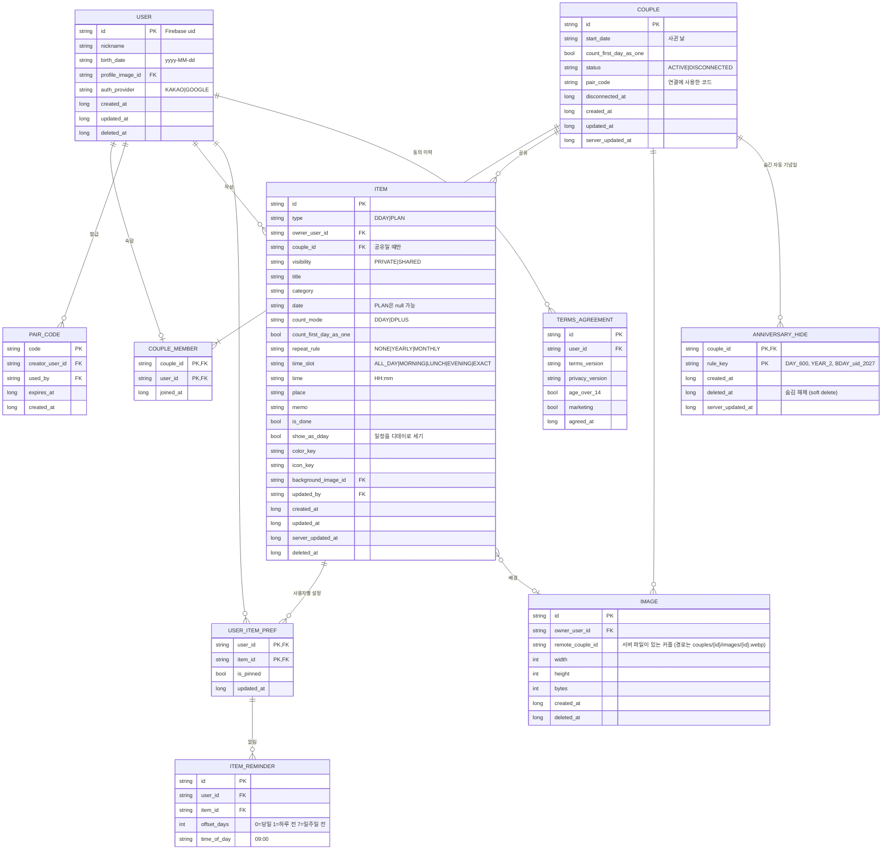

# 데이터 모델 · ERD

## 1. 마이그레이션을 위한 설계 원칙

| 원칙 | 내용 | 이유 |
|---|---|---|
| ID | 기기에서 생성한 **UUID 문자열**. 자동 증가 숫자 금지 | Room · Firestore · 서버에서 같은 ID 사용 |
| 날짜 | `yyyy-MM-dd` 문자열 (LocalDate) | 디데이는 시간대 문제에 취약. 시각이 아니라 날짜로 저장 |
| 시각 | epoch millis (Long) | `createdAt`, `updatedAt`, `deletedAt` |
| 삭제 | soft delete (`deletedAt`) | 상대 기기에 삭제 전달 |
| 열거형 | 대문자 문자열 (`DDAY`, `SHARED`) | 숫자 코드보다 서버 이전 시 안전 |
| 공유 / 개인 분리 | 대표 고정 · 알림은 사용자별 테이블 | 같은 공유 디데이라도 사람마다 다르게 설정 |
| 동기화 메타 | `syncState`, 커서는 Room에만 | 서버 스키마를 오염시키지 않음 |

### 공유 데이터와 개인 설정을 분리하는 이유

"홈 대표 고정"과 "알림"을 디데이 항목에 넣으면, 지민이 고정을 바꾸는 순간 현우의 홈 히어로도 바뀝니다. 그래서 항목(ITEM)은 공유하고, 사람별 설정(USER_ITEM_PREF, ITEM_REMINDER)은 각자 기기에만 둡니다.

## 2. 논리 ERD (자체 서버 기준)



### 항목 타입별 사용 컬럼

디데이와 일정은 하나의 `ITEM` 테이블에 `type`으로 구분합니다. 동기화 대상이 하나로 줄고, 일정 ↔ 디데이 전환("디데이로 세기")이 쉬워집니다.

| 컬럼 | DDAY | PLAN |
|---|---|---|
| `date` | 필수 | 선택 (없으면 "하고 싶은 것") |
| `count_mode`, `count_first_day_as_one`, `repeat_rule` | 사용 | – |
| `time_slot`, `time`, `place`, `is_done` | – | 사용 |
| `show_as_dday` | – | 켜면 홈 리스트 · 위젯에 D-day로 표시 |

### 자동 기념일 `rule_key` 규칙

| 종류 | 형식 | 예 |
|---|---|---|
| 100일 단위 | `DAY_{n}` | `DAY_600` |
| 주년 | `YEAR_{n}` | `YEAR_2` |
| 생일 | `BDAY_{uid}_{연도}` | `BDAY_abc123_2027` |

자동 기념일 자체는 저장하지 않고 계산하며, 사용자가 숨긴 것만 `ANNIVERSARY_HIDE`에 저장합니다.

## 3. 저장소별 배치

| 엔티티 | Room | Firestore | 자체 서버 |
|---|---|---|---|
| USER | 내 프로필 + 상대 프로필 캐시 | `users/{uid}` | `users` |
| COUPLE + MEMBER | 계정별 내 커플 (`members` 2명을 `member1_user_id` 발급자 · `member2_user_id` 입력자 컬럼으로) | `couples/{coupleId}` (`members` 배열로 합침) | `couples` + `couple_members` |
| PAIR_CODE | ✗ | `pairCodes/{code}` | `pair_codes` |
| ITEM (나만 보기) | ✓ | ✗ (백업 기능 추가 시 `users/{uid}/items`) | `items` |
| ITEM (우리 둘이) | ✓ | `couples/{coupleId}/items/{itemId}` | `items` |
| USER_ITEM_PREF, ITEM_REMINDER | ✓ (내 것만) | ✗ | 기기 간 동기화가 필요해지면 추가 |
| IMAGE | 로컬 경로 + 업로드 상태 | 사진 id만 항목 · 프로필 문서에 (`backgroundImageId` · `profileImageId`), 파일은 Cloud Storage | `images` + 오브젝트 스토리지 (S3 호환으로 옮김) |
| ANNIVERSARY_HIDE | ✓ | `couples/{coupleId}/hiddenAnniversaries/{ruleKey}` | `anniversary_hides` |
| TERMS_AGREEMENT | ✗ | `users/{uid}` 안의 필드 | `terms_agreements` |
| 위젯 설정, 테마, 활동 알림 | ✓ (또는 DataStore) | ✗ | ✗ |

### Room에만 있는 컬럼 · 테이블

| 대상 | 추가 컬럼 / 테이블 |
|---|---|
| 동기화 대상 테이블 (item, couple, anniversary_hide, user) | `sync_state` (PENDING / SYNCED / FAILED). `user`는 내 행만 올리고 상대 행은 받기만 한다 |
| image | `local_path` (filesDir 기준, 받기 전이면 null), `upload_state` (`NONE` · `REJECTED` 한도 초과) |
| item | `copied_from_item_id` (커플 해제 때 만든 나만 보기 사본의 원본 id. 30일 안 재연결 때 고치지 않은 사본 정리) |
| `sync_cursor` | `key` (예: `items:{coupleId}`, `hiddenAnniversaries:{coupleId}`), `last_pulled_at_micros` (Firestore 서버 시각이 마이크로초라 이 컬럼만 마이크로초. 밀리초로 자르면 같은 문서를 매번 다시 읽는다) |
| `activity_log` | 알림 목록 (id, user_id(보는 계정), type(`ITEM_ADDED` · `ITEM_UPDATED` · `ITEM_DELETED` · `REMINDER` · `ANNIVERSARY`), item_id, item_type, item_title(기록 당시 제목), actor_user_id, offset_days(REMINDER), rule_key(ANNIVERSARY), created_at, is_read). 기기에만, 30일 보관 |
| `widget_config` | widget_id, item_id, size, background_type, show_profile. widget_id는 시스템이 주는 appWidgetId(정수)라 UUID 원칙의 예외 (기기 밖으로 나가지 않음) |

## 4. Firestore · Storage 저장 구조

```
users/{uid}
  nickname (1~10자), birthDate (yyyy-MM-dd, 없으면 null), profileImageId (지금 커플에 올린 사진만), authProvider, coupleId, serverUpdatedAt,
  termsVersion, privacyVersion, ageOver14, marketing, agreedAt,
  marketingUpdatedAt (알림 설정에서 마케팅 수신을 바꾼 시각, epoch millis. 없으면 agreedAt),
  updatedAt

pairCodes/{code}
  creatorUid, creatorNickname (1~10자, 확인 화면용), usedBy, expiresAt, createdAt

couples/{coupleId}
  members: [uidA, uidB], pairCode, startDate, countFirstDayAsOne,
  status, disconnectedAt, createdAt, updatedAt, serverUpdatedAt

couples/{coupleId}/items/{itemId}
  ITEM 필드와 동일 (visibility는 항상 SHARED)
  backgroundImageId (사진 id만. 경로는 couples/{coupleId}/images/{id}.webp)

couples/{coupleId}/hiddenAnniversaries/{ruleKey}
  createdAt, deletedAt (숨김 해제), serverUpdatedAt

couples/{coupleId}/usage/images
  count  (커플당 누적 업로드 수, 규칙이 +1씩 · 30 이하로만 허용)
  lastImageId  (방금 등록한 사진 id. Storage 규칙이 이 id의 파일만 새로 만들게 한다)

Cloud Storage (Storage 보안 규칙: 커플 멤버만, webp · 300KB 이하, 덮어쓰기 금지, 공개 URL 없음)
  couples/{coupleId}/images/{imageId}.webp
```

## 5. Room Entity 예시

```kotlin
@Entity(
    tableName = "item",
    indices = [Index("couple_id"), Index("date"), Index("sync_state")]
)
data class ItemEntity(
    @PrimaryKey val id: String,                      // UUID
    val type: String,                                // DDAY | PLAN
    @ColumnInfo(name = "owner_user_id") val ownerUserId: String,
    @ColumnInfo(name = "couple_id") val coupleId: String?,
    val visibility: String,                          // PRIVATE | SHARED
    val title: String,
    val category: String,
    val date: String?,                               // yyyy-MM-dd
    @ColumnInfo(name = "count_mode") val countMode: String?,
    @ColumnInfo(name = "count_first_day_as_one") val countFirstDayAsOne: Boolean = false,
    @ColumnInfo(name = "repeat_rule") val repeatRule: String = "NONE",
    @ColumnInfo(name = "time_slot") val timeSlot: String?,
    val time: String?,                               // HH:mm
    val place: String?,
    val memo: String?,
    @ColumnInfo(name = "is_done") val isDone: Boolean = false,
    @ColumnInfo(name = "show_as_dday") val showAsDday: Boolean = false,
    @ColumnInfo(name = "color_key") val colorKey: String,
    @ColumnInfo(name = "icon_key") val iconKey: String,
    @ColumnInfo(name = "background_image_id") val backgroundImageId: String?,
    @ColumnInfo(name = "updated_by") val updatedBy: String,
    @ColumnInfo(name = "created_at") val createdAt: Long,
    @ColumnInfo(name = "updated_at") val updatedAt: Long,
    @ColumnInfo(name = "server_updated_at") val serverUpdatedAt: Long?,
    @ColumnInfo(name = "deleted_at") val deletedAt: Long?,
    @ColumnInfo(name = "sync_state") val syncState: String = "PENDING"  // Room 전용
)

@Entity(tableName = "user_item_pref", primaryKeys = ["user_id", "item_id"])
data class UserItemPrefEntity(
    @ColumnInfo(name = "user_id") val userId: String,
    @ColumnInfo(name = "item_id") val itemId: String,
    @ColumnInfo(name = "is_pinned") val isPinned: Boolean = false,
    @ColumnInfo(name = "updated_at") val updatedAt: Long
)
```

- Room 컬럼명을 처음부터 **snake_case**로 맞춰두면 서버 테이블과 이름이 그대로 일치합니다.
- Firestore DTO는 camelCase로 두고, 매퍼에서 변환합니다.

## 6. 자체 서버로 옮길 때

1. 테이블 · 컬럼 이름은 Room과 동일(snake_case)하게 생성합니다.
2. Firestore `couples.members` 배열은 `couple_members` 테이블로 풉니다.
3. `serverUpdatedAt`은 서버의 `updated_at` 트리거 값으로 대체합니다.
4. Firestore 데이터를 내보내 ID 그대로 적재합니다. UUID · 날짜 형식이 같아 변환이 필요 없습니다.
5. 앱은 `SyncRemoteDataSource` 구현체만 `ApiSyncDataSource`로 교체합니다. 일정 기간 두 구현체를 동시에 쓰는 이중 쓰기(dual write)로 안전하게 전환할 수 있습니다.

### 서버 DDL 예시 (PostgreSQL)

```sql
CREATE TABLE items (
  id                     UUID PRIMARY KEY,
  type                   TEXT NOT NULL CHECK (type IN ('DDAY','PLAN')),
  owner_user_id          TEXT NOT NULL REFERENCES users(id),
  couple_id              UUID REFERENCES couples(id),
  visibility             TEXT NOT NULL CHECK (visibility IN ('PRIVATE','SHARED')),
  title                  TEXT NOT NULL,
  category               TEXT NOT NULL,
  date                   DATE,
  count_mode             TEXT,
  count_first_day_as_one BOOLEAN NOT NULL DEFAULT FALSE,
  repeat_rule            TEXT NOT NULL DEFAULT 'NONE',
  time_slot              TEXT,
  time                   TIME,
  place                  TEXT,
  memo                   TEXT,
  is_done                BOOLEAN NOT NULL DEFAULT FALSE,
  show_as_dday           BOOLEAN NOT NULL DEFAULT FALSE,
  color_key              TEXT NOT NULL,
  icon_key               TEXT NOT NULL,
  background_image_id    UUID REFERENCES images(id),
  updated_by             TEXT NOT NULL REFERENCES users(id),
  created_at             BIGINT NOT NULL,
  updated_at             BIGINT NOT NULL,
  server_updated_at      TIMESTAMPTZ NOT NULL DEFAULT now(),
  deleted_at             BIGINT
);
CREATE INDEX idx_items_couple_sync ON items (couple_id, server_updated_at);
```
